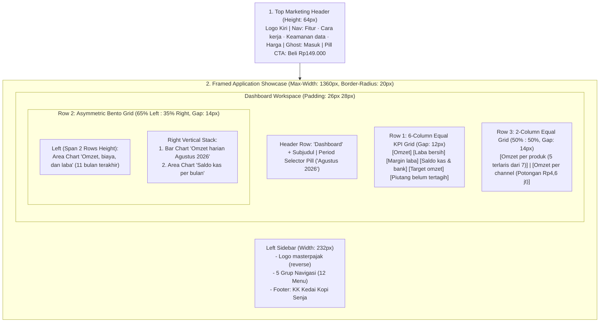

# DESIGN.md — Design Brief & Design System Specification
**Produk**: Master Pajak (PT Master Pajak Indonesia)  
**Brand**: Brand Guideline Master Pajak v1.0, lihat §2. Tagline: *Jualan lancar, pajak beres.*
**Component Stack**: `shadcn/ui` + `Kokonut UI` + `21st.dev` + Tailwind CSS  
**Guardrails**: `antislop` · `taste` · `impeccable` · `ui ux pro max` · `ponytail`

---

## 1. Executive Design Brief (Dari Gambar Referensi)

### 1.1 Esensi Visual & Mood
Desain **Master Pajak** memakai permukaan terang dan netral dengan biru DJP sebagai warna brand dan satu aksen kuning per layar (§2). Alih-alih menampilkan tabel akuntansi padat yang mengintimidasi pemilik UMKM, antarmuka ini menerjemahkan ribuan transaksi (`4.425 transaksi`) menjadi **satu layar cerita visual yang langsung menjawab 3 pertanyaan pemilik bisnis dalam 5 detik**:
1. *"Apakah bisnis saya untung dan mencapai target bulan ini?"* → Dijawab oleh **Omzet (`Rp92 jt`)**, **Laba bersih (`Rp25 jt`)**, **Margin (`27%`)**, dan **Target omzet (`108%`)**.
2. *"Kemana perginya uang kas saya?"* → Dijawab oleh **Saldo kas & bank (`Rp97 jt`)**, grafik **Saldo kas per bulan**, serta kartu **Omzet per channel (`Potongan aplikasi bulan ini Rp4,6 jt`)**.
3. *"Siapa yang belum bayar tagihan dan apa yang harus segera ditagih?"* → Dijawab oleh kartu **Piutang belum tertagih (`Rp11 jt`)** dengan highlight merah menyala **`Rp9,6 jt lewat 30 hari`**.

### 1.2 Prinsip Utama (`Taste` & `Impeccable`)
- **Rupiah penuh**: Semua nilai uang ditulis lengkap dengan titik ribuan (`Rp92.450.000`), tanpa desimal sen. Singkatan `jt` hanya untuk label sumbu grafik. Keputusan pengguna 21 Oktober 2026 (checklist tester #12) menggantikan format ringkas `Rp92 jt`; contoh `jt` di bagian lain dokumen ini berasal dari mockup lama.
- **Educational Micro-Copy**: Setiap metrik berisiko salah paham disertai penjelasan singkat langsung di dalam kartu (contoh: *"Kas bisa turun walau laba positif: cek halaman Arus Kas."*).
- **Color-Coded Financial Semantics**: Warna tidak pernah dipakai sebagai dekorasi kosong; setiap warna mewakili satu konsep finansial yang konsisten di seluruh layar.

---

## 2. Brand, Warna & Design Tokens

**Sumber kebenaran: Brand Guideline Master Pajak v1.0 (Oktober 2026)**, salinan di [`docs/brand/Brand Guideline MasterPajak AI v1.0.pdf`](docs/brand/Brand%20Guideline%20MasterPajak%20AI%20v1.0.pdf). Bila dokumen ini berbeda dengan PDF, ikuti PDF. Brand sementara 19 Oktober 2026 (navy `#222852`, emas `#F5C428`, logo segitiga "A", nama "Laporan Bisnis by Master Pajak") sudah tidak berlaku.

### 2.1 Logo
- Logo = monogram **M dua warna** (kiri biru, kanan kuning, bertemu di lembah) + wordmark **`masterpajak`** Rubik Bold. Komponen: `frontend/src/components/Logo.tsx` (`<Logo tinggi={24} />`, `<Monogram />`). Konstruksi SVG mengikuti hlm. 8 (grid 100, tebal garis 13, ujung membulat).
- Warna logo dari token: `--ink` (master + kaki kiri) dan `--logo-pajak` (pajak). Di `:root` = versi **utama** (navy 700 + royal 600); di dalam `.dark` = versi **reverse** (putih + kuning). Jadi logo di sidebar, panel login/onboarding, dan header AI otomatis reverse.
- Monogram sendiri hanya untuk ikon aplikasi, favicon (`frontend/public/favicon.svg`), dan avatar (header AI). Materi publik selalu monogram + wordmark.
- Tinggi minimum 24 px di layar. Jangan ubah proporsi, warna, font wordmark, atau menambah efek. Jangan pasang versi utama di latar kuning (bagian kuning hilang).
- Nama produk di UI: wordmark `masterpajak`; dalam kalimat ditulis "Master Pajak". "Laporan Bisnis" tidak lagi dipakai sebagai nama produk (tetap boleh sebagai nama laporan, misalnya "Ringkasan Laporan Bisnis" di jawaban AI).
- Footer landing wajib memuat: aplikasi independen milik PT Master Pajak Indonesia, tidak berafiliasi dengan DJP, pelaporan tetap melalui Coretax DJP (warna inti diambil dari logo DJP).

### 2.2 Palet (hlm. 13–14)
Skala mentah didefinisikan sekali di `:root` (`frontend/src/index.css`), komponen memakai token semantik di 2.3.

| Skala | Nilai |
|---|---|
| `--navy-*` | 50 `#EEF0F7` · 100 `#DDE1EE` · 200 `#B9C0DA` · 300 `#8E99C2` · 500 `#3A4889` · 600 `#26367A` (Biru Royal) · 700 `#212C5F` (Biru DJP) · 800 `#1A234B` · 900 `#131B40` (Biru Tegas) |
| `--yellow-*` | 50 `#FFFBE6` · 100 `#FFF4C2` · 300 `#FFE466` · 500 `#FED111` (Kuning) · 600 `#E7B220` (Emas) · 700 `#B7860F` |
| `--neutral-*` | 0 `#FFFFFF` · 50 `#F6F7FB` (Awan) · 100 `#EDEFF5` · 200 `#E1E5EE` · 400 `#98A1B5` · 600 `#5B6478` (Abu Biru) · 900 `#161D3A` (Teks) |
| Semantik | `--success #2E9B5B` · `--warning #D9822B` · `--error #D64545` · `--info #2F6FD6` |

Proporsi: 60% netral & putih, 30% biru, 7% teks, **kuning maksimal 3%**: satu titik, garis, sorotan, atau satu CTA berbayar per layar. Kuning tidak pernah menjadi teks di latar terang (kontras 1,5).

### 2.3 Token semantik
**Tema terang adalah default** (Brand Guideline: 60% netral). Kelas `.dark` di `<html>` dipasang hanya bila pengguna memilih gelap (`localStorage.tema === 'gelap'`, lihat `lib/theme.ts`). Mode gelap tidak ada di PDF; nilainya diturunkan dari skala navy.

| Token | Terang | Gelap |
|---|---|---|
| `--bg-shell` / `--bg-outer` | neutral 50 / neutral 50 | navy 900 / `#0E1430` |
| `--bg-card` / `--bg-card-hover` / `--bg-raised` | putih / navy 50 / neutral 100 | navy 800 / navy 700 / `#161F47` |
| `--bg-sidebar` | navy 700 | `#0E1430` |
| `--border-subtle` / `--border-shell` / `--border-strong` | neutral 200 / `#D3D8E4` / navy 200 | putih 8% / putih 12% / navy 500 |
| `--text-primary` / `--text-secondary` / `--text-muted` | `#161D3A` / `#5B6478` / `#687084` | neutral 50 / navy 200 / navy 300 |
| `--primary` / `--primary-hover` / `--primary-foreground` | navy 700 / navy 900 / putih | kuning 500 / kuning 600 / navy 900 |
| `--ink` / `--link` / `--text-brand` | navy 700 / navy 600 / navy 600 | putih / navy 200 / kuning 500 |
| `--chart-1` (omzet) / `--chart-1-dim` | navy 600 / navy 200 | navy 200 / navy 500 |
| `--chart-2` biaya / `--chart-3` laba / `--chart-4` kas | warning / success / info | versi lebih terang |
| `--text-profit` / `--text-danger` / `--text-warn` / `--text-info` | `#217A47` / `#B83232` / `#9A5A14` / `#2558B0` | `#6FD49A` / `#FF9090` / `#F5B86E` / `#9CBDF5` |
| `--ring` | kuning 500 (fokus, hlm. 22) | kuning 500 |
| `--shadow-1` / `-2` / `-3` | kartu & input / dropdown / modal (hlm. 20) | sama, lebih pekat |

Aturan:
- Jangan menulis hex atau kelas palet Tailwind (`bg-slate-*`, `text-emerald-*`) di komponen; pakai token. Pengecualian: `favicon.svg`.
- `--text-warn` / `.pill-amber` hanya untuk peringatan sungguhan (lewat jatuh tempo, stok menipis, belum lunas, neraca tidak seimbang). Sorotan brand (angka omzet, hasil pajak, periode, peran Owner, "Bentuk usaha Anda") memakai `--text-brand` / `.pill-brand`.
- Badge status (hlm. 23): `.pill-green` (Cocok/Lunas), `.pill-amber` (Selisih/peringatan), `.pill-red` (Kurang bayar/terlambat), `.pill-status-muted` (Draf), `.pill-brand` (penanda netral).
- Pulau gelap: sidebar, panel login/onboarding, kartu sorotan navy, dan header AI diberi kelas `dark` karena berlatar navy di kedua tema.
- Tanpa gradasi, bayangan tebal, atau efek 3D (hlm. 18). Isi area grafik datar dengan opasitas rendah.

### 2.4 Komponen (hlm. 22–24)
- **Tombol** (`ui/button.tsx`): `default` = primer (satu per layar), `outline` = sekunder bergaris `--ink`, `ghost` = teks, `accent` = kuning **hanya untuk ajakan berbayar/promosi** (bayar paket, aktifkan langganan, CTA daftar di band navy). Tinggi `sm` 32 · `default` 40 · `lg` 48, radius 10, fokus ring kuning 2 px + offset 2.
- `.btn-cta` = tombol primer lama (navy/kuning sesuai tema); `.btn-cta.accent` = kuning berbayar.
- **Input/Select/Combobox**: tinggi 40, radius 10, fokus border `--primary` + halo `--primary` 25%.
- **Kartu**: radius 16, border `--border-subtle`, `--shadow-1`. Dialog radius 16, `--shadow-3`, overlay navy 900 45%.
- **Navigasi**: item aktif sidebar = kotak navy pekat + teks putih; tab aktif = garis bawah `--primary`; segmented aktif = chip `--primary` terisi.

---

## 3. Tipografi (hlm. 15–16)

1. **Rubik** (500, 700): display, judul halaman, `h1`/`h2`, judul kartu/dialog (`font-heading`), wordmark. Token `--font-heading`.
2. **Public Sans** (400–800): teks, antarmuka, tabel, dan semua angka. Token `--font-sans`. Cadangan: Segoe UI, Roboto, Arial. Dimuat dari Google Fonts di `frontend/index.html`.
3. Skala:
   - **display** Rubik Bold 48/56 (hero landing; 40/48 di ponsel).
   - **h1 / judul halaman** (`.workspace-title`) Rubik Bold 32/40; 24/32 di layar < 760 px.
   - **h2** Rubik Medium/Bold 24/32.
   - **h3 / judul kartu** (`.chart-title`) Public Sans Bold 15–18.
   - **body** Public Sans 16/24 (antarmuka padat 13–14).
   - **caption** Public Sans 13/18.
   - **label** (`.label-caps`, header tabel, label grup sidebar) Public Sans Bold 12, spasi 8%, kapital.
   - **angka** (`.kpi-value`, nominal tabel) Public Sans Bold, **`font-variant-numeric: tabular-nums`**.
4. Kode inline memakai monospace sistem (`--font-mono`); JetBrains Mono dan Plus Jakarta Sans tidak dipakai lagi.

### 3.1 Tone of voice (hlm. 5–6)
- Sapaan "kamu/Anda" yang lugas, angka konkret, satu tindakan jelas. Contoh: "Omzet kamu Rp4,3 M. Sisa Rp500 jt sebelum wajib jadi PKP."
- Kata yang dipakai: beres, rapi, cocok, aman, hemat, didampingi, otomatis.
- Hindari: sanksi/denda di judul, jargon AI, istilah tanpa penjelasan, kalimat menakut-nakuti ("Awas, salah hitung bisa langsung kena SP2DK!"), bahasa sistem ("Sistem mendeteksi anomali data pada entitas Anda").
- Jangan menjanjikan bebas pajak atau bebas pemeriksaan.

---

## 4. Layout & Spatial Architecture

---

## 5. Spesifikasi Komponen Detail (`shadcn/ui` + `Kokonut UI` + `21st.dev`)

### 5.1 Top Marketing Bar
Mengikuti mockup final "MasterPajak AI" (artifact 24 Okt 2026, `views/Landing.tsx`): header putih, `<Logo tinggi={26} />` kiri, tautan `Kalkulator gratis` · `Klinik Master` · `Harga` · `FAQ` (`--text-secondary`, tampil mulai `lg`), tombol sekunder `Masuk` + primer `Beli sekarang`. Hero 2 kolom (headline + slot video 16:9), lalu pita slogan *Jualan jalan terus, pajaknya AI yang urus.* dan maskot robot Master (`views/landing/RobotMaster.tsx`).

### 5.2 Sidebar Navigasi (5 Grup, 12 Menu)
- **Lebar Tetap**: `232px`, `border-right: 1px solid rgba(255,255,255,0.06)`.
- **Struktur Menu & Ikon (Lucide Icons `15px`, stroke `1.75px`)**:
  1. `RINGKASAN`: `LayoutGrid` **Dashboard** (aktif: kotak navy 900 70% di atas navy 700, teks putih, radius 10).
  2. `LAPORAN`: `FileText` **Laporan Keuangan**, `WalletCards` **Arus Kas**.
  3. `OPERASIONAL`: `ArrowLeftRight` **Transaksi**, `FileSpreadsheet` **Piutang & Utang**, `Package` **Stok & Gudang**, `Factory` **Produksi & Supplier**.
  4. `ALAT`: `Receipt` **Invoice**, `SlidersHorizontal` **Simulasi & Harga**, `ShieldCheck` **Pajak UMKM**.
  5. `PENGATURAN`: `Database` **Master Data**, `BookOpen` **Panduan**.
- **Sidebar Footer (Tenant Switcher)**:
  - Kartu berbingkai halus (`border-radius: 10px`, padding `9px 10px`) berisi lingkaran inisial `KK` (titik kuning 500, teks navy 900), nama bisnis **`Kedai Kopi Senja`**, subteks **`FnB · 4.425 transaksi`**, dan footnote di luar kartu: `Data contoh tidak disimpan`.

### 5.3 Enam Kartu KPI (Baris 1)
Seluruh kartu memakai `.card` (radius 16, padding 16, `--bg-card`, border `--border-subtle`, `--shadow-1`). Warna seri: omzet & margin `--chart-1`, laba `--chart-3`, kas `--chart-4`, progres target `--accent-green`. Warna hex di bawah adalah catatan referensi lama:
1. **Kartu 1 (`Omzet`)**:Nilai `Rp92 jt` | Pill hijau `▲ 4%` + `vs bulan lalu` | Sparkline `--chart-1` menanjak halus.
2. **Kartu 2 (`Laba bersih`)**: Nilai `Rp25 jt` | Pill hijau `▲ 11%` + `vs bulan lalu` | Sparkline `--chart-3` dengan lembah di tengah (Maret) lalu naik.
3. **Kartu 3 (`Margin laba`)**: Nilai `27%` | Teks hijau tanpa pill `+1,7 poin` + `vs bulan lalu` | Sparkline `--chart-1`.
4. **Kartu 4 (`Saldo kas & bank`)**: Nilai `Rp97 jt` | Pill hijau `▲ 21%` + baris baru `sejak awal bulan` | Sparkline `--chart-4` menanjak di ujung kanan.
5. **Kartu 5 (`Target omzet`)**: Nilai `108%` | Subteks `Lebih Rp6,8 jt` | Progress bar horizontal penuh berwarna hijau `#22C55E` (`height: 6px`, `border-radius: 999px`).
6. **Kartu 6 (`Piutang belum tertagih`)**: Nilai `Rp11 jt` | Baris 1: `10 tagihan` (`#949BA6`) | Baris 2: **`Rp9,6 jt lewat 30 hari`** (`#F43F5E` merah terang) | Baris 3: `Utang belum dibayar Rp7,4 jt` (`#5E6572`).

### 5.4 Tiga Grafik Tengah (Baris 2)
1. **Grafik Kiri — `Omzet, biaya, dan laba` (`11 bulan terakhir`)**:
   - **Legenda Horizontal**: `● Omzet` (`--chart-1`), `● Total biaya` (`--chart-2`), `● Laba bersih` (`--chart-3`).
   - **Sumbu Y**: `0`, `25 jt`, `50 jt`, `75 jt`, `100 jt` dengan garis bantu horizontal tipis.
   - **Sumbu X**: 11 titik bulan dari `Okt 25`, `Nov 25`, `Des 25`, `Jan 26`, `Feb 26`, `Mar 26`, `Apr 26`, `Mei 26`, `Jun 26`, `Jul 26`, hingga `Agu 26`.
   - **Visual**: Kurva spline mulus (*monotone cubic interpolation*) dengan isi datar opasitas 8% di bawah kurva Omzet dan Laba bersih (tanpa gradasi), serta titik bulat (`r=3.5`) pada ujung kanan (`Agu 26`).
2. **Grafik Kanan Atas — `Omzet harian Agustus 2026`**:
   - **Subjudul**: `Rata-rata Rp3 jt per hari.`
   - **Legenda**: `● Di atas target` (`--chart-1`), `● Di bawah target` (`--chart-1-dim`), `— Target harian`.
   - **Visual**: 31 batang vertikal (tanggal 1–31), garis putus-putus horizontal pada level `3 jt` dengan label `Target harian Rp3 jt`.
3. **Grafik Kanan Bawah — `Saldo kas per bulan`**:
   - **Subjudul**: `Kas bisa turun walau laba positif: cek halaman Arus Kas.`
   - **Legenda**: `● Kas akhir bulan` (`--chart-4`).
   - **Visual**: Area chart biru langit dari `Okt 25` s/d `Agu 26` yang memperlihatkan penurunan kas di `Mar 26` lalu naik ke `Rp97 jt` di `Agu 26`.

### 5.5 Dua Kartu Bawah (Baris 3)
1. **Kiri — `Omzet per produk`**: Subjudul `5 terlaris dari 7 produk`, menampilkan daftar peringkat produk dengan bar kontribusi/nominal.
2. **Kanan — `Omzet per channel`**: Subjudul `Potongan aplikasi bulan ini Rp4,6 jt`, menampilkan perbandingan channel penjualan beserta potongan komisinya.

---

## 6. Anti-Slop Checklist (`antislop` & `impeccable`)
- ❌ **Dilarang** memakai gradasi, warna di luar palet §2.2 (ungu, emerald, teal, dsb.), atau kuning lebih dari satu sorotan per layar.
- ❌ **Dilarang** menggunakan border putih tebal (`> 1px`) atau *drop shadow* berwarna terang pada kartu dalam.
- ❌ **Dilarang** menampilkan angka panjang tak terformat di KPI utama (`Rp 92.000.000,00` → wajib disingkat `Rp92 jt` untuk KPI utama).
- ❌ **Dilarang** memakai emoji di UI, jawaban AI Agent, laporan, dan ekspor. Pakai teks atau ikon `lucide-react` (dijaga oleh `TestAnswer_NoEmoji`).
- ✅ **Wajib** mempertahankan kepadatan informasi tinggi yang tetap lega berkat kontras tipografi dan ruang kosong; ritme vertikal kelipatan 8 px, lebar konten maks. 1200 px, paragraf maks. 68 karakter (hlm. 21).

