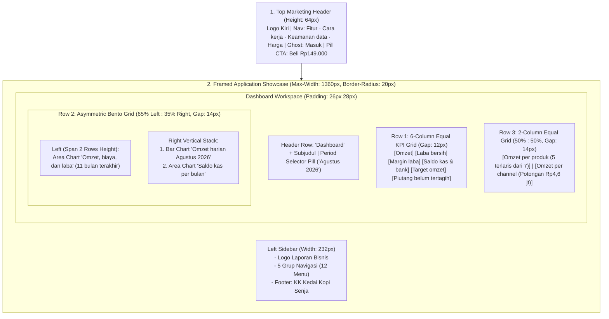

# DESIGN.md — Design Brief & Design System Specification
**Produk**: Laporan Bisnis by Master Pajak  
**Aesthetic Persona**: *Navy & Gold* (latar brand navy, permukaan laporan netral gelap)
**Component Stack**: `shadcn/ui` + `Kokonut UI` + `21st.dev` + Tailwind CSS  
**Guardrails**: `antislop` · `taste` · `impeccable` · `ui ux pro max` · `ponytail`

---

## 1. Executive Design Brief (Dari Gambar Referensi)

### 1.1 Esensi Visual & Mood
Desain **Laporan Bisnis by Master Pajak** memadukan ketenangan visual *dark-mode* kelas eksekutif (seperti Linear / Mercury / Stripe Dark) dengan kehangatan aksen **Warm Gold / Amber (`#EAB308`)** khas identitas Master Pajak. Alih-alih menampilkan tabel akuntansi padat yang mengintimidasi pemilik UMKM, antarmuka ini menerjemahkan ribuan transaksi (`4.425 transaksi`) menjadi **satu layar cerita visual yang langsung menjawab 3 pertanyaan pemilik bisnis dalam 5 detik**:
1. *"Apakah bisnis saya untung dan mencapai target bulan ini?"* → Dijawab oleh **Omzet (`Rp92 jt`)**, **Laba bersih (`Rp25 jt`)**, **Margin (`27%`)**, dan **Target omzet (`108%`)**.
2. *"Kemana perginya uang kas saya?"* → Dijawab oleh **Saldo kas & bank (`Rp97 jt`)**, grafik **Saldo kas per bulan**, serta kartu **Omzet per channel (`Potongan aplikasi bulan ini Rp4,6 jt`)**.
3. *"Siapa yang belum bayar tagihan dan apa yang harus segera ditagih?"* → Dijawab oleh kartu **Piutang belum tertagih (`Rp11 jt`)** dengan highlight merah menyala **`Rp9,6 jt lewat 30 hari`**.

### 1.2 Prinsip Utama (`Taste` & `Impeccable`)
- **Glanceable Indonesian Currency Formatting**: Angka utama menggunakan format ringkas berbahasa Indonesia (`Rp92 jt`, `Rp25 jt`, `Rp6,8 jt`) agar tidak memenuhi kartu dengan deretan nol (`Rp92.000.000,00`), namun tetap presisi.
- **Educational Micro-Copy**: Setiap metrik berisiko salah paham disertai penjelasan singkat langsung di dalam kartu (contoh: *"Kas bisa turun walau laba positif: cek halaman Arus Kas."*).
- **Color-Coded Financial Semantics**: Warna tidak pernah dipakai sebagai dekorasi kosong; setiap warna mewakili satu konsep finansial yang konsisten di seluruh layar.

---

## 2. Color System & Design Tokens

**Keputusan brand — 19 Oktober 2026:** warna utama adalah **navy `#222852`**, dipilih pengguna untuk membangun asosiasi dengan perpajakan/DJP. Pedoman lengkap ada di `DESIGN.md` §2. Aksen emas (`#F5C428` / `#EAB308`) dipertahankan karena kedua kode warna yang diberikan sama. Navy digunakan pada login/onboarding, sidebar, favicon, warna tema browser, dan teks tombol emas; area laporan tetap netral gelap.

### 2.1 Surface & Background Hierarchy
| Token | Hex / Nilai CSS | Penggunaan pada Gambar Referensi |
|---|---|---|
| `--bg-canvas` | `#090A0C` | Background paling luar (halaman landing & area di luar frame aplikasi). |
| `--bg-ambient-glow` | `radial-gradient(ellipse at top, rgba(234,179,8,0.08), transparent 65%)` | Pendar hangat tipis di belakang frame aplikasi bagian atas. |
| `--bg-app-shell` | `#0F1115` | Kanvas utama area kerja Dashboard di sebelah kanan sidebar. |
| `--bg-sidebar` | `var(--brand-navy)` / `#222852` | Latar belakang sidebar navigasi kiri. |
| `--bg-card` | `#161920` | Permukaan seluruh kartu KPI dan kartu grafik. |
| `--bg-card-elevated` | `#1B1F27` | Permukaan dropdown pemilih bulan (`Agustus 2026`), pill profil tenant (`Kedai Kopi Senja`), dan hover state. |
| `--border-hairline` | `rgba(255, 255, 255, 0.06)` (`#1F232B`) | Garis tepi `1px` pada seluruh kartu KPI, grafik, dan pemisah sidebar. |
| `--border-frame` | `rgba(255, 255, 255, 0.10)` | Bingkai luar kontainer aplikasi (`border-radius: 20px`). |

### 2.2 Brand & Semantic Financial Colors
| Token | Hex | Peran Semantik |
|---|---|---|
| `--brand-navy` | `#222852` | Warna brand utama: login, onboarding, sidebar, favicon, serta teks tombol emas. |
| `--brand-gold` | `#F5C428` / `#EAB308` | Logo segitiga **A**, tombol CTA utama `Beli Rp149.000`, kurva & sparkline **Omzet**, bar **Di atas target**. |
| `--brand-gold-muted` | `#785C12` / `rgba(234, 179, 8, 0.35)` | Bar omzet harian **Di bawah target**, fill area bawah kurva Omzet. |
| `--brand-gold-pill` | `rgba(234, 179, 8, 0.14)` | Latar belakang menu sidebar aktif (`Dashboard`) dengan teks `#FACC15`. |
| `--finance-profit` | `#10B981` (Emerald) | Kurva & sparkline **Laba bersih**, progress bar **Target omzet (`108%`)**, teks `+1,7 poin`. |
| `--finance-profit-pill`| `rgba(16, 185, 129, 0.15)` | Latar badge pertumbuhan positif (`▲ 4%`, `▲ 11%`, `▲ 21%`) dengan teks `#34D399`. |
| `--finance-cost` | `#D97706` (Warm Orange/Amber) | Kurva tengah **Total biaya** pada grafik 11 bulan terakhir. |
| `--finance-cash` | `#38BDF8` (Sky Blue) | Sparkline **Saldo kas & bank** dan kurva area **Kas akhir bulan**. |
| `--finance-danger` | `#F43F5E` (Rose Red) | Teks peringatan jatuh tempo **`Rp9,6 jt lewat 30 hari`** pada kartu Piutang. |

### 2.3 Text Hierarchy
| Level | Hex | Penggunaan |
|---|---|---|
| `--text-primary` | `#F4F5F7` | Judul `Dashboard`, angka KPI (`Rp92 jt`, `27%`, `108%`), judul grafik, link aktif `Masuk`. |
| `--text-secondary` | `#949BA6` | Subjudul halaman, nama metrik (`Omzet`, `Laba bersih`), item menu sidebar inaktif, nav link atas. |
| `--text-muted` | `#5E6572` | Label grup sidebar (`RINGKASAN`, `LAPORAN`, dll.), label sumbu X/Y grafik (`Okt 25`, `25 jt`), teks `vs bulan lalu`, `Data contoh tidak disimpan`. |

---

## 3. Typography & Numeric Rules

1. **Primary UI & Display Font**: **`Plus Jakarta Sans`** (atau **`Inter`**)
   - Karakter huruf geometris modern yang sangat bersih pada latar gelap dan memiliki keterbacaan angka tinggi untuk nominal Rupiah.
2. **Sub-Brand Monospace Font**: **`JetBrains Mono`** (atau **`Geist Mono`**)
   - Digunakan khusus pada teks `by Master Pajak` di bawah logo **Laporan Bisnis** dengan `letter-spacing: 0.06em`.
3. **Skala Tipografi (Type Scale)**:
   - **Page Title (`Dashboard`)**: `24px` (`1.5rem`), `font-weight: 700`, `letter-spacing: -0.025em`.
   - **KPI Hero Value (`Rp92 jt`, `108%`)**: `26px–28px`, `font-weight: 800`, `letter-spacing: -0.03em`, **`font-variant-numeric: tabular-nums`**.
   - **Card / Chart Header (`Omzet, biaya, dan laba`)**: `15px`, `font-weight: 700`, `letter-spacing: -0.01em`.
   - **Sidebar Menu Item**: `13px`, `font-weight: 500` (inaktif) / `600` (aktif).
   - **Subtitle & Card Label**: `11.5px–12.5px`, `font-weight: 500`, color `--text-secondary`.
   - **Sidebar Group Header (`RINGKASAN`, `OPERASIONAL`)**: `10px`, `font-weight: 700`, `text-transform: uppercase`, `letter-spacing: 0.09em`, color `--text-muted`.

---

## 4. Layout & Spatial Architecture

---

## 5. Spesifikasi Komponen Detail (`shadcn/ui` + `Kokonut UI` + `21st.dev`)

### 5.1 Top Marketing Bar
- **Kiri**: Ikon monogram segitiga emas (`#F5C428`) + teks vertikal **Laporan Bisnis** (`16px Bold`) dan `by Master Pajak` (`11px Monospace Muted`).
- **Kanan**:
  - 4 tautan teks (`Fitur`, `Cara kerja`, `Keamanan data`, `Harga`) — `14px`, `#949BA6`.
  - Tombol `Masuk` — `border-radius: 9999px`, `border: 1px solid rgba(255,255,255,0.14)`, background `#121418`, padding `9px 22px`.
  - Tombol CTA `Beli Rp149.000` — `border-radius: 9999px`, background `#F5C428`, teks navy `#222852` (`font-weight: 700`), padding `10px 24px`.

### 5.2 Sidebar Navigasi (5 Grup, 12 Menu)
- **Lebar Tetap**: `232px`, `border-right: 1px solid rgba(255,255,255,0.06)`.
- **Struktur Menu & Ikon (Lucide Icons `15px`, stroke `1.75px`)**:
  1. `RINGKASAN`: `LayoutGrid` **Dashboard** (Active state: background `rgba(234,179,8,0.14)`, teks & ikon `#FACC15`, radius `9px`).
  2. `LAPORAN`: `FileText` **Laporan Keuangan**, `WalletCards` **Arus Kas**.
  3. `OPERASIONAL`: `ArrowLeftRight` **Transaksi**, `FileSpreadsheet` **Piutang & Utang**, `Package` **Stok & Gudang**, `Factory` **Produksi & Supplier**.
  4. `ALAT`: `Receipt` **Invoice**, `SlidersHorizontal` **Simulasi & Harga**, `ShieldCheck` **Pajak UMKM**.
  5. `PENGATURAN`: `Database` **Master Data**, `BookOpen` **Panduan**.
- **Sidebar Footer (Tenant Switcher)**:
  - Kartu berbingkai halus (`border-radius: 12px`, padding `9px 10px`) berisi lingkaran inisial `KK` (latar emas transparan `rgba(234,179,8,0.2)`, teks `#FACC15`), nama bisnis **`Kedai Kopi Senja`**, subteks **`FnB · 4.425 transaksi`**, dan footnote di luar kartu: `Data contoh tidak disimpan`.

### 5.3 Enam Kartu KPI (Baris 1)
Seluruh kartu memiliki `border-radius: 14px`, `padding: 15px 16px`, `background: #161920`, dan `border: 1px solid rgba(255,255,255,0.06)`:
1. **Kartu 1 (`Omzet`)**:Nilai `Rp92 jt` | Pill hijau `▲ 4%` + `vs bulan lalu` | Sparkline SVG kuning `#EAB308` menanjak halus.
2. **Kartu 2 (`Laba bersih`)**: Nilai `Rp25 jt` | Pill hijau `▲ 11%` + `vs bulan lalu` | Sparkline SVG hijau `#10B981` dengan lembah di tengah (Maret) lalu naik.
3. **Kartu 3 (`Margin laba`)**: Nilai `27%` | Teks hijau tanpa pill `+1,7 poin` + `vs bulan lalu` | Sparkline SVG kuning-emas `#D4A338`.
4. **Kartu 4 (`Saldo kas & bank`)**: Nilai `Rp97 jt` | Pill hijau `▲ 21%` + baris baru `sejak awal bulan` | Sparkline SVG biru `#38BDF8` menanjak di ujung kanan.
5. **Kartu 5 (`Target omzet`)**: Nilai `108%` | Subteks `Lebih Rp6,8 jt` | Progress bar horizontal penuh berwarna hijau `#22C55E` (`height: 6px`, `border-radius: 999px`).
6. **Kartu 6 (`Piutang belum tertagih`)**: Nilai `Rp11 jt` | Baris 1: `10 tagihan` (`#949BA6`) | Baris 2: **`Rp9,6 jt lewat 30 hari`** (`#F43F5E` merah terang) | Baris 3: `Utang belum dibayar Rp7,4 jt` (`#5E6572`).

### 5.4 Tiga Grafik Tengah (Baris 2)
1. **Grafik Kiri — `Omzet, biaya, dan laba` (`11 bulan terakhir`)**:
   - **Legenda Horizontal**: `● Omzet` (`#EAB308`), `● Total biaya` (`#D97706`), `● Laba bersih` (`#10B981`).
   - **Sumbu Y**: `0`, `25 jt`, `50 jt`, `75 jt`, `100 jt` dengan garis bantu horizontal tipis.
   - **Sumbu X**: 11 titik bulan dari `Okt 25`, `Nov 25`, `Des 25`, `Jan 26`, `Feb 26`, `Mar 26`, `Apr 26`, `Mei 26`, `Jun 26`, `Jul 26`, hingga `Agu 26`.
   - **Visual**: Kurva spline mulus (*monotone cubic interpolation*) dengan gradien vertikal lembut di bawah kurva Omzet (kuning ke transparan) dan Laba bersih (hijau ke transparan), serta titik bulat (`r=3.5`) pada ujung kanan (`Agu 26`).
2. **Grafik Kanan Atas — `Omzet harian Agustus 2026`**:
   - **Subjudul**: `Rata-rata Rp3 jt per hari.`
   - **Legenda**: `● Di atas target` (`#EAB308`), `● Di bawah target` (`#785C12`), `— Target harian`.
   - **Visual**: 31 batang vertikal (tanggal 1–31), garis putus-putus horizontal pada level `3 jt` dengan label `Target harian Rp3 jt`.
3. **Grafik Kanan Bawah — `Saldo kas per bulan`**:
   - **Subjudul**: `Kas bisa turun walau laba positif: cek halaman Arus Kas.`
   - **Legenda**: `● Kas akhir bulan` (`#38BDF8`).
   - **Visual**: Area chart biru langit dari `Okt 25` s/d `Agu 26` yang memperlihatkan penurunan kas di `Mar 26` lalu naik ke `Rp97 jt` di `Agu 26`.

### 5.5 Dua Kartu Bawah (Baris 3)
1. **Kiri — `Omzet per produk`**: Subjudul `5 terlaris dari 7 produk`, menampilkan daftar peringkat produk dengan bar kontribusi/nominal.
2. **Kanan — `Omzet per channel`**: Subjudul `Potongan aplikasi bulan ini Rp4,6 jt`, menampilkan perbandingan channel penjualan beserta potongan komisinya.

---

## 6. Anti-Slop Checklist (`antislop` & `impeccable`)
- ❌ **Dilarang** menggunakan gradien ungu/indigo/neon cyberpunk yang tidak ada di referensi.
- ❌ **Dilarang** menggunakan border putih tebal (`> 1px`) atau *drop shadow* berwarna terang pada kartu dalam.
- ❌ **Dilarang** menampilkan angka panjang tak terformat di KPI utama (`Rp 92.000.000,00` → wajib disingkat `Rp92 jt` untuk KPI utama).
- ✅ **Wajib** mempertahankan kepadatan informasi (*information density*) tinggi yang tetap lega berkat kontras tipografi dan *negative space* gelap `#0F1115` / `#161920`.

