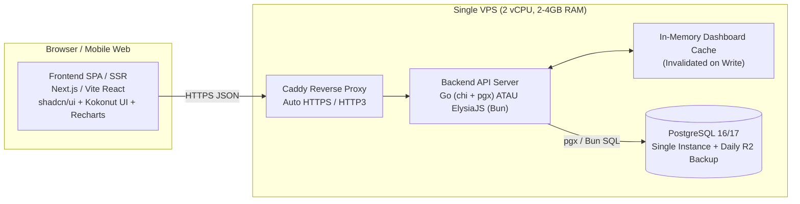

# Technical Requirements Document (TRD)
**Produk**: Laporan Bisnis by Akademi Pajak  
**Kapasitas Target**: **100 Active UMKM Tenants** (Early Stage Production)  
**Kandidat Backend**: **Go (Golang 1.23+)** vs **ElysiaJS (Bun 1.x)**  
**Prinsip Arsitektur**: *Ponytail (YAGNI, Single-Node Simplicity, Zero Unnecessary Infrastructure)*

---

## 1. Estimasi Beban Kerja & Sizing (100 UMKM Users)

Mengacu pada profil tenant referensi di desain (`Kedai Kopi Senja · FnB · 4.425 transaksi`):
- **Jumlah Tenant Aktif**: `100 UMKM`
- **Rata-rata Transaksi per Tenant**: `~5.000 transaksi / tahun` (`~15–25 transaksi / hari`)
- **Total Baris Transaksi Sistem / Tahun**: `100 × 5.000 = 500.000 baris / tahun`
- **Ukuran Data PostgreSQL / Tahun**: `500.000 baris × ~500 bytes ≈ 250 MB / tahun` (termasuk indeks `< 1 GB / tahun`).
- **Trafik HTTP (Peak Hour — jam 20:00–22:00 saat tutup kasir)**:
  - Concurrent active users: `~25–40 user bersamaan`
  - Rata-rata Request Per Second (RPS): `~5–15 RPS` (Burst hingga `100 RPS`).

> [!IMPORTANT]
> **Kesimpulan Sizing (`ponytail`)**: Untuk 100 user (bahkan hingga 5.000 user), **1 VPS (2 vCPU, 2–4 GB RAM, 40 GB NVMe SSD)** sudah sangat berlebih (*over-provisioned*). Tidak diperlukan microservices, Redis cluster, atau message broker eksternal.

---

## 2. Komparasi Backend: ElysiaJS (Bun) vs Go (Golang) untuk 100 User

Kedua runtime (`bun` dan `go`) sudah terinstal dan siap di environment pengembangan ini. Berikut perbandingan objektif untuk skala 100 UMKM:

| Aspek Teknis | **ElysiaJS (Bun)** | **Go (Golang `net/http` / `chi` + `sqlc`)** | Pemenang & Catatan |
|---|---|---|---|
| **Throughput (RPS pada 2 vCPU)** | ~60.000 – 90.000 req/sec | ~80.000 – 120.000 req/sec | **Seri untuk 100 user** (kebutuhan riil hanya < 100 RPS). |
| **Konsumsi RAM Idle / 100 User** | ~45 MB – 90 MB | **~15 MB – 35 MB** | **Go** unggul hemat memori di VPS murah. |
| **End-to-End Type Safety (FE ↔ BE)** | **Elysia Eden Treaty** (otomatis sinkron tipe TypeScript ke React/Next.js tanpa codegen) | Perlu OpenAPI / `sqlc` + TypeScript codegen | **ElysiaJS** unggul kecepatan iterasi full-stack TypeScript. |
| **Keamanan Aritmatika Finansial** | `BigInt` di JS/TS (perlu serializer JSON custom karena `JSON.stringify` tidak dukung `BigInt` secara native) | **`int64` native** (`Rp` utuh) + `shopspring/decimal` untuk persentase | **Go** lebih aman & ergonomis untuk komputasi akuntansi/pajak. |
| **Deployment Artifact** | `bun build --compile` (single binary ~90MB) atau jalankan TS langsung via Bun | **`go build` static binary (~15MB)**, 0 dependency runtime | **Go** unggul di reliabilitas binary produksi & kemudahan deploy. |
| **Concurrency & PDF/CSV Export** | Single-threaded event loop + `Worker` untuk generate PDF invoice | **Goroutines ringan** (cetak 100 PDF & rekap pajak paralel tanpa blokir event loop) | **Go** unggul saat ada batch export laporan/CSV. |

### Rekomendasi Arsitektur (`Decision Matrix`)
1. **Pilih ElysiaJS (Bun)** jika prioritas utama adalah **kecepatan *shipping* MVP 1–2 minggu** dengan 1 bahasa (TypeScript dari database Drizzle/Kysely → API Elysia → Frontend React/Next.js menggunakan **Eden Treaty**).
2. **Pilih Go (Golang)** jika prioritas utama adalah **presisi finansial jangka panjang, binary 15MB yang tidak pernah rewel di VPS kecil, dan konkurensi pemrosesan laporan/pajak/CSV**.
3. **Arsitektur Modular yang Disiapkan**: Kontrak API dan skema PostgreSQL di bawah ini dirancang **100% kompatibel** untuk dijalankan di **Go** maupun **ElysiaJS**.

---

## 3. Arsitektur Sistem & Tech Stack



---

## 4. Desain Skema Database (PostgreSQL)

> **Aturan Emas Finansial**: Semua nilai mata uang disimpan dalam tipe **`BIGINT`** dalam satuan **Rupiah utuh** (contoh: `Rp92.000.000` disimpan sebagai `92000000`). Persentase disimpan dalam **basis points (`INT`)** (contoh: `27,00%` = `2700`, `0,5%` pajak UMKM = `50`).

```sql
-- 1. Tenants (Bisnis UMKM)
CREATE TABLE tenants (
    id UUID PRIMARY KEY DEFAULT gen_random_uuid(),
    name TEXT NOT NULL,                          -- Contoh: "Kedai Kopi Senja"
    category TEXT NOT NULL DEFAULT 'FnB',        -- FnB, Ritel, Jasa, Produksi
    tax_entity_type TEXT NOT NULL DEFAULT 'OP',  -- 'OP' (Orang Pribadi - bebas pajak s/d 500jt) | 'BADAN'
    monthly_revenue_target BIGINT NOT NULL DEFAULT 85000000,
    daily_revenue_target BIGINT NOT NULL DEFAULT 3000000,
    is_paid BOOLEAN NOT NULL DEFAULT FALSE,
    created_at TIMESTAMPTZ NOT NULL DEFAULT NOW()
);

-- 2. Cash & Bank Accounts (Saldo Kas & Bank)
CREATE TABLE accounts (
    id UUID PRIMARY KEY DEFAULT gen_random_uuid(),
    tenant_id UUID NOT NULL REFERENCES tenants(id) ON DELETE CASCADE,
    name TEXT NOT NULL,                          -- Kas Tunai, BCA Bisnis, Mandiri
    opening_balance BIGINT NOT NULL DEFAULT 0,
    current_balance BIGINT NOT NULL DEFAULT 0
);

-- 3. Sales Channels (Channel Penjualan & Potongan Aplikasi)
CREATE TABLE sales_channels (
    id UUID PRIMARY KEY DEFAULT gen_random_uuid(),
    tenant_id UUID NOT NULL REFERENCES tenants(id) ON DELETE CASCADE,
    name TEXT NOT NULL,                          -- Offline/Dine-in, GoFood, GrabFood, ShopeeFood
    fee_bps INT NOT NULL DEFAULT 0,              -- Contoh: 2000 = 20.00% komisi aplikasi
    fixed_fee_rp BIGINT NOT NULL DEFAULT 0
);

-- 4. Products & Inventory (Produk, HPP & Stok)
CREATE TABLE products (
    id UUID PRIMARY KEY DEFAULT gen_random_uuid(),
    tenant_id UUID NOT NULL REFERENCES tenants(id) ON DELETE CASCADE,
    sku TEXT,
    name TEXT NOT NULL,
    item_type TEXT NOT NULL DEFAULT 'FINISHED',  -- 'FINISHED' | 'RAW_MATERIAL'
    sell_price BIGINT NOT NULL DEFAULT 0,
    cogs_per_unit BIGINT NOT NULL DEFAULT 0,     -- HPP per unit (Weighted Average)
    stock_qty NUMERIC(12,2) NOT NULL DEFAULT 0,
    unit TEXT NOT NULL DEFAULT 'pcs'
);

-- 5. Transactions (Pemasukan, Pengeluaran, HPP, & Potongan Aplikasi)
CREATE TABLE transactions (
    id UUID PRIMARY KEY DEFAULT gen_random_uuid(),
    tenant_id UUID NOT NULL REFERENCES tenants(id) ON DELETE CASCADE,
    tx_date DATE NOT NULL,
    tx_type TEXT NOT NULL,                       -- 'INCOME' | 'EXPENSE'
    category TEXT NOT NULL,                      -- 'SALES', 'COGS', 'OPEX_SALARY', 'OPEX_RENT', dll.
    gross_amount BIGINT NOT NULL,                -- Omzet kotor sebelum potongan aplikasi
    channel_fee_amount BIGINT NOT NULL DEFAULT 0,-- Potongan aplikasi (misal GoFood)
    cogs_amount BIGINT NOT NULL DEFAULT 0,       -- Total HPP transaksi
    net_amount BIGINT NOT NULL,                  -- Kas bersih yang diterima/dikeluarkan
    account_id UUID REFERENCES accounts(id),
    channel_id UUID REFERENCES sales_channels(id),
    product_id UUID REFERENCES products(id),
    qty NUMERIC(12,2) DEFAULT 1,
    notes TEXT,
    created_at TIMESTAMPTZ NOT NULL DEFAULT NOW()
);
CREATE INDEX idx_tx_tenant_date ON transactions(tenant_id, tx_date);

-- 6. Receivables & Payables (Piutang & Utang / Invoice)
CREATE TABLE obligations (
    id UUID PRIMARY KEY DEFAULT gen_random_uuid(),
    tenant_id UUID NOT NULL REFERENCES tenants(id) ON DELETE CASCADE,
    kind TEXT NOT NULL,                          -- 'RECEIVABLE' (Piutang) | 'PAYABLE' (Utang)
    invoice_number TEXT NOT NULL,
    counterparty_name TEXT NOT NULL,             -- Nama Pelanggan / Supplier
    issue_date DATE NOT NULL,
    due_date DATE NOT NULL,
    total_amount BIGINT NOT NULL,
    paid_amount BIGINT NOT NULL DEFAULT 0,
    status TEXT NOT NULL DEFAULT 'UNPAID'        -- 'UNPAID' | 'PARTIAL' | 'PAID'
);
CREATE INDEX idx_ob_tenant_kind_due ON obligations(tenant_id, kind, status, due_date);
```

---

## 5. Spesifikasi Endpoint API Utama

### `GET /api/v1/dashboard?period=2026-08`
Mengembalikan seluruh payload yang dibutuhkan layar **Dashboard** dalam **1 HTTP request** (`latency < 15ms`):
```json
{
  "tenant": {
    "name": "Kedai Kopi Senja",
    "category": "FnB",
    "total_transactions": 4425,
    "is_demo": true
  },
  "period": "2026-08",
  "period_label": "Agustus 2026",
  "kpis": {
    "omzet": { "value": 92000000, "display": "Rp92 jt", "delta_pct": 4.0, "trend": "up" },
    "laba_bersih": { "value": 25000000, "display": "Rp25 jt", "delta_pct": 11.0, "trend": "up" },
    "margin_laba": { "value_pct": 27.0, "display": "27%", "delta_pts": 1.7, "trend": "up" },
    "saldo_kas": { "value": 97000000, "display": "Rp97 jt", "delta_pct": 21.0, "trend": "up" },
    "target_omzet": { "achieved_pct": 108, "surplus_value": 6800000, "surplus_display": "Lebih Rp6,8 jt" },
    "piutang": {
      "unpaid_total": 11000000,
      "unpaid_display": "Rp11 jt",
      "invoice_count": 10,
      "overdue_30d_total": 9600000,
      "overdue_30d_display": "Rp9,6 jt lewat 30 hari",
      "payable_unpaid_total": 7400000,
      "payable_unpaid_display": "Utang belum dibayar Rp7,4 jt"
    }
  },
  "charts": {
    "monthly_trend_11m": [
      { "month": "Okt 25", "omzet": 72000000, "total_biaya": 51000000, "laba_bersih": 21000000 }
    ],
    "daily_omzet": {
      "avg_daily": 3000000,
      "daily_target": 3000000,
      "days": [
        { "day": 1, "omzet": 3800000, "above_target": true }
      ]
    },
    "monthly_cash_balance": [
      { "month": "Okt 25", "ending_cash": 54000000 }
    ]
  },
  "top_products": {
    "total_products": 7,
    "top_5": [
      { "name": "Es Kopi Susu Senja", "omzet": 34500000, "qty": 1916 }
    ]
  },
  "channels": {
    "total_app_fees": 4600000,
    "total_app_fees_display": "Potongan aplikasi bulan ini Rp4,6 jt",
    "items": [
      { "name": "Dine-in & Takeaway", "gross": 52000000, "fee": 0, "net": 52000000 },
      { "name": "GoFood", "gross": 23000000, "fee": 2600000, "net": 20400000 },
      { "name": "GrabFood", "gross": 17000000, "fee": 2000000, "net": 15000000 }
    ]
  }
}
```

### Endpoint Modul Lainnya
- `GET /api/v1/reports/financial?period=2026-08` — Laba Rugi & Neraca.
- `GET /api/v1/reports/cashflow?period=2026-08` — Laporan Arus Kas & Rekonsiliasi Laba vs Kas.
- `POST /api/v1/transactions` & `GET /api/v1/transactions` — Input & daftar transaksi + auto-invalidation cache dashboard.
- `GET /api/v1/obligations` & `POST /api/v1/obligations/:id/pay` — Piutang & Utang.
- `GET /api/v1/tax/umkm?year=2026` — Kalkulasi Pajak UMKM PP 55/2022 (akumulasi omzet tahunan, deteksi batas Rp500 juta WP OP, PPh 0,5% per bulan).

---

## 6. Keamanan Data & Non-Functional Requirements (NFR)
1. **Keamanan Data**:
   - Enkripsi TLS 1.3 penuh (via Caddy).
   - Password di-hash menggunakan `Argon2id`.
   - Session berbasis `HttpOnly, Secure, SameSite=Lax` cookie + JWT/Session Token.
   - Setiap query database wajib menyertakan `WHERE tenant_id = $1`.
2. **Backup & Disaster Recovery**:
   - Cron job harian (`pg_dump` terkompresi `zstd` + enkripsi `age`) diunggah otomatis ke Cloudflare R2 (gratis hingga 10 GB/bulan).
3. **Performa**:
   - Waktu muat API Dashboard `< 20ms` (p95).
   - Skor Lighthouse Performance & Accessibility `> 95`.

