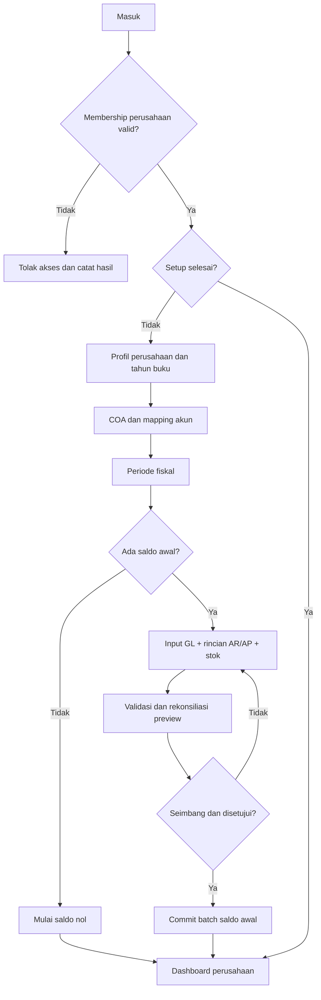
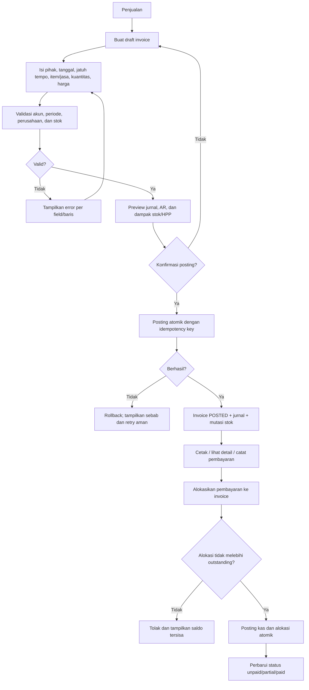
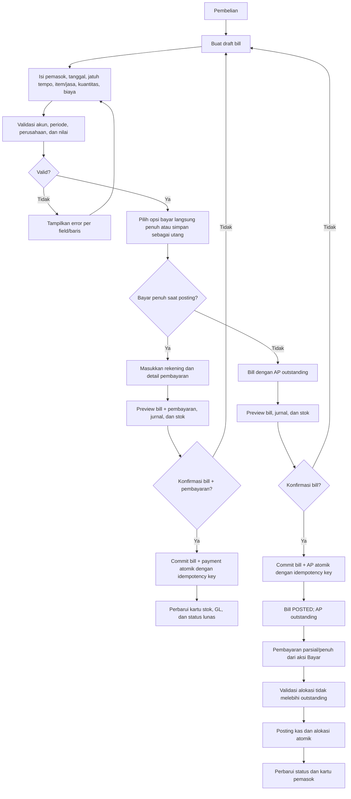
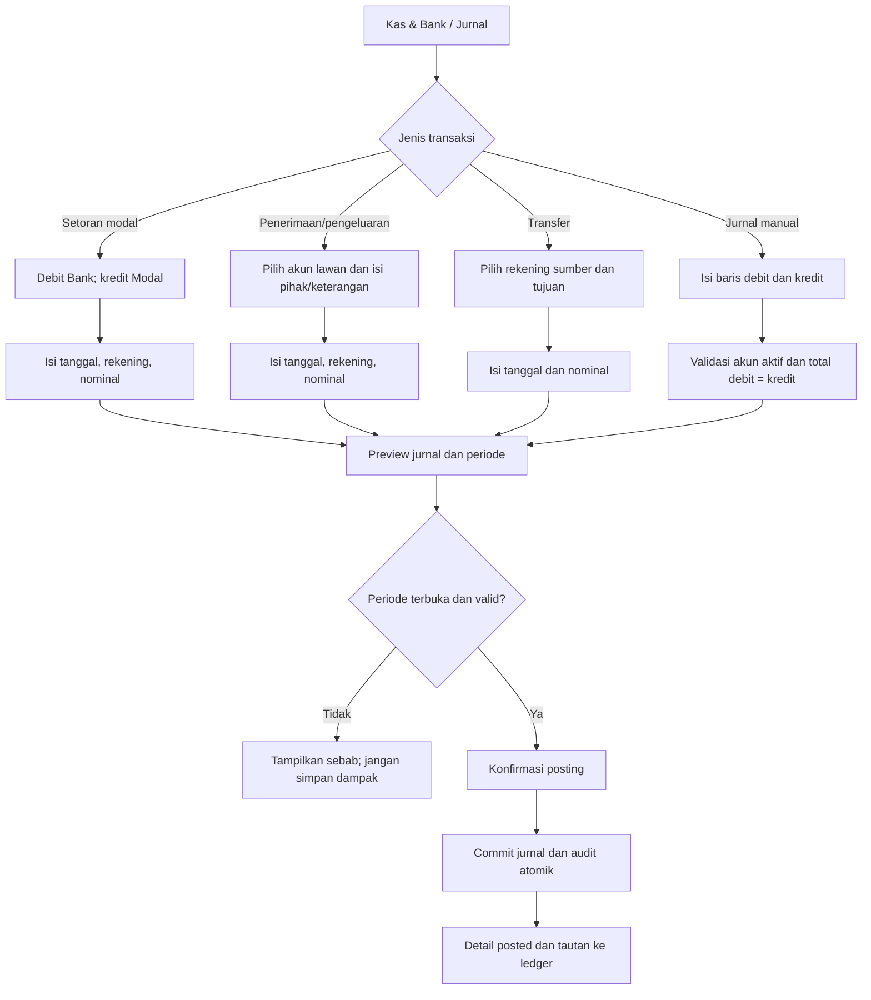

# App Flow — Platform Akuntansi Jasa & Dagang

**Status:** Alur baseline MVP  
**Rujukan:** [FRD](FRD.md) · [PRD](PRD.md) · [Design Brief](DESIGN_BRIEF.md)

## 1. Setup perusahaan dan saldo awal

## 2. Invoice penjualan

Untuk jasa, alur invoice sama tetapi tidak menimbulkan mutasi stok/HPP persediaan.

## 3. Bill pembelian dan pembayaran

Untuk jasa, bill tidak menerima stok dan tidak menghitung HPP persediaan.

## 4. Kas/bank dan jurnal manual

## 5. Koreksi dan reversal

1. Pengguna membuka dokumen posted dan memilih **Buat reversal**.
2. Sistem memeriksa izin, periode terbuka, reversal sebelumnya, pembayaran aktif, serta aturan stok.
3. Pengguna memasukkan alasan; sistem menampilkan preview akun dan dampak pembalik.
4. Jika valid dan dikonfirmasi, reversal serta jurnal/alokasi/mutasi terkait disimpan atomik dengan referensi silang.
5. Sistem menampilkan hasil dan tautan dokumen asal/pengganti.

Jika ada pembayaran aktif, balik alokasi/pembayaran terlebih dahulu. Reversal stok ditolak jika item/gudang telah memiliki mutasi sesudah dokumen tersebut.

## 6. Laporan dan drill-down

`Laporan → pilih jenis → pilih periode/as-of date → lihat ringkasan/detail → buka baris → jurnal → dokumen sumber`. Filter yang sama dipakai untuk ekspor PDF/Excel. Saldo historis menghitung transaksi hingga tanggal laporan.

## 7. Impor dan kondisi umum

`Pilih jenis impor → unggah → pemeriksaan format/ukuran → preview dan error per baris → perbaiki sumber atau batalkan → validasi saldo/duplicate → konfirmasi commit → hasil batch dan audit`. Retry batch yang sama tidak boleh menggandakan data.

Semua alur memiliki loading, empty, error, validasi, dan akses-terlarang state. Kegagalan posting tidak meninggalkan data parsial; error menyebut tindakan perbaikan yang aman.
